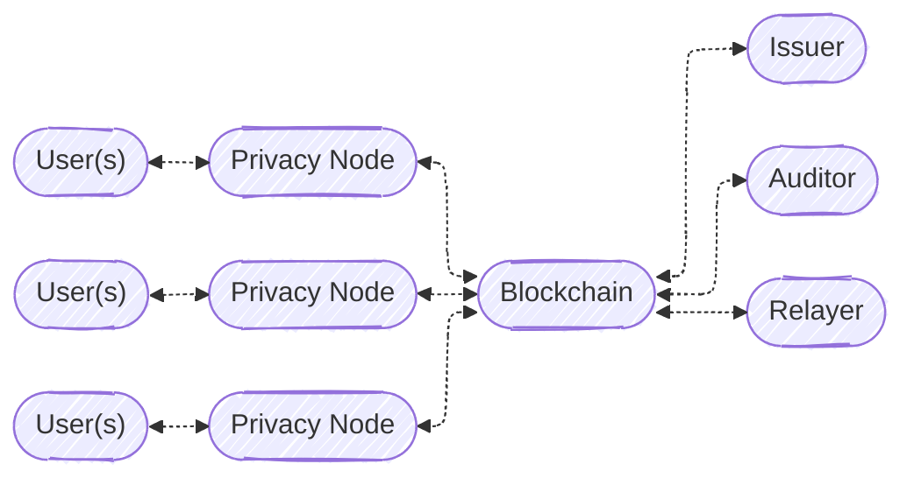
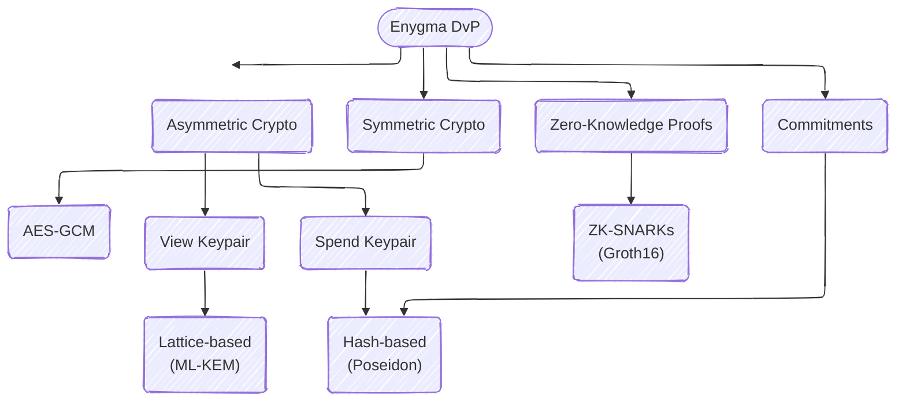

# Enygma Delivery-vs-Payment (DvP)

## Motivation

Enygma Dvp is privacy preserving Delivery-versus-Payment (DvP) protocol built on EVM compatible blockchains. It allows two parties to atomically swap private assets, such as ERC20 and ERC721 (the ERC1155 vault is retired, [ADR 0003](../docs/adr/0003-retire-the-legacy-erc1155-vault.md)). Without revealing amounts, identities or assets linkage on-chain. Moving assets into or out of a vault is public, though: see [what the chain sees](./dvp_protocol.md#what-the-chain-sees-deposits-spends-and-exits).

## System Architecture

Our system is simple: **users** (e.g., a bank customers) are directly connected to **privacy nodes** (i.e., a high-performance single-node EVM blockchain). Each of the privacy nodes, is connected to a **private network hub**, which effectively acts as a bulletin board for all privacy nodes to leverage as a universal (encrypted) messaging layer and verification layer. **Issuer(s)** are the managers/admins of specific assets on the private network hub. Optionally, there is an **auditor** that oversees (some of) the transactions that take place in the network. A more formal protocol description is documented [here](./protocol_description.md).

An optional **relayer** is an authorized off-chain service that can submit both legs of a DvP swap atomically in a single transaction. When a relayer is present, Alice and Bob submit their proofs to the relayer off-chain; the relayer then calls `EnygmaDvp.swap` or `exchange` (or their `swapOnGroupPair` / `exchangeOnGroupPair` forms) on-chain, collapsing the two-phase flow into one atomic settlement. Without a relayer, Alice and Bob interact with the contract directly via `submitPartialSettlement`. The `SwapRelayer.sol` contract is test-only and must never be registered as a relayer ([why](./dvp_protocol.md#swaprelayer-is-test-only)).



## Protocol Overview

Two parities agree off-chain on the terms of the trade. Alice initiates the swap by submitting an on-chain transaction containing a zero-knowledge proof, an ML-KEM ciphertext addressed to Bob, and a set of output commitments. The blockchain locks Alice's nullifier and records a `swap_id`. Bob scans the chain, decrpyts the payload using his view key, verifies the commitments, generates his own proof, and submits it to finalize the swap. If Bob does not respond before the deadline, Alice and reclaim her funds via a pre-committed revert path.

The protocol accept two settlement paths

- Direct: Alice and Bob each call submitPartialSettlement independently.
- Relayer: Alice and Bob submit their proofs off-chain to a registered relayer.

For the full formal specification — key generation, commitment structure,
step-by-step cryptographic protocol, and security goals — see [here](./dvp_protocol.md)

## Cryptographic Primitives



Note: We intend to update the ZK module to use a quantum-secure ZK scheme, which will make the entire system quantum-secure (as opposed to quantum-private). We also intend to leverage the ability of having [Single-Server Private Outsourcing of zk-SNARKs
](https://eprint.iacr.org/2025/2113) to allow clients to submit ZK proofs to the Private Network Hub component of the system without incurring in unnecessary hardware costs.

## Deprecated: enygma_dvp's `EnygmaAuction`

`enygma_dvp/contracts/core/contracts/EnygmaAuction.sol` is a legacy contract.
The maintained auction is the contract of the same name in
[`enygma_dvp_auctions`](../enygma_dvp_auctions): a standalone deployment with
its own vaults, verifier and proof server. It uses neither `EnygmaDvp` nor
`registerEnygmaAuction` and auctions only notes held in its own vaults. Use
that module for auctions.

**The owner must never pass enygma_dvp's `EnygmaAuction` to
`EnygmaDvp.registerEnygmaAuction`.** Nothing registers it today: no deploy or
init script calls `registerEnygmaAuction`, and this module's gnark server
(`gnark_circuits/`, port 8081) serves none of the `/proof/auction*` routes
that `src/core/prover_auction.go` posts to.

The gaps below matter only for vaults registered after a registration.
`registerEnygmaAuction` stores the address, and `registerVault` hands it to
each vault it registers from then on. That vault grants it
`DEFAULT_AUCTION_ROLE` once, at initialization, and has no role admin to
revoke the grant. Vaults registered earlier granted the role to whatever
address was stored then (today, `address(0)`). A later `registerEnygmaAuction`
call with another address neither re-points nor revokes an existing grant: a
vault registered while the legacy contract was stored lets it call
`lockCoin`, `unlockCoin`, `nullifyCoin` and `registerCoins` for good.

Once registered, the contract has these gaps:

- **`newAuction` checks no Merkle root.** Unlike `submitBid`, it never calls
  `verifyRoot` for the init proof, and locking rejects only zero, locked or
  spent nullifiers. The item note a seller "locks" therefore need not exist in
  the item vault.
- **`newAuction` trusts its `uniqueIdParams`.** No proof binds them, or any of
  its other plain arguments, to the item note. `declareWinner` later mints
  the winner's item from the stored params. Because `newAuction` has no sender
  check, whoever submits the init receipt first sets them: the seller, or a
  front-runner who copies an honest seller's receipt from the mempool.
- **`submitBid` takes `receivingPublicKey` as a plain argument.** The bid
  proof does not commit to it, so whoever submits the bid transaction (a
  relayer or a front-runner) chooses which key receives the item.
- **`declareWinner` never reads `sellerFundPublicKey`.** `newAuction` stores
  the seller's payout key, but settlement registers the output commitments of
  the winner's own bid proof, whose keys the bidder chose. A winning bidder can
  pay itself and take the item for nothing.
- **`declareWinner` has no state or time check, and can leave losing bids
  locked** (reconciled audit R-084). `_verifyNotWinningProofs` needs only
  `numberOfOpenedBids - 1` proofs, and `_unlockLosersBids` unlocks only bids
  with a proof.
- **The vault calls this contract uses check nothing beyond the caller's
  role** (R-052). `nullifyCoin`
  sets a nullifier without the `isLocked` check that `_spendNullifier`
  applies, and `lockCoin` and `unlockCoin` take a raw (tree, nullifier) with no
  owner. Only this contract calls `nullifyCoin`.

The contract stays in the tree because the registration hook still exists
and `test/11_v2_auction_declarewinner_test.go` deploys its artifact (its
NatSpec says the same). Editing `EnygmaAuction.sol` itself changes only its own
artifact: of the two auction files, `EnygmaDvp` imports
only the interface `IEnygmaAuction.sol`, and no vault imports either. What would change `EnygmaDvp`, the vaults and retail's deployed
copies is an edit to `EnygmaDvp.sol`, to the interfaces it imports
(`IEnygmaAuction.sol`, `IEnygmaDvp.sol`), to the vault sources, or to any
other file they import.

## Repository Structure

```
enygma_dvp/
├── contracts/          Solidity smart contracts (Hardhat project)
├── artifacts/          Hardhat compilation outputs — DO NOT overwrite PoseidonT3/T5 (see Poseidon.sol)
├── build/              Deployment receipts (receipts.json) + gnark VK exports consumed by scripts/cmd/init
├── src/                Go core library (provers, crypto, Merkle tree, scan helpers)
├── gnark_circuits/     ZK proof server — REST API wrapping gnark Groth16 circuits
├── relayer/             Off-chain relayer service — collects proofs from both parties and submits them to EnygmaDvp
├── scripts/            Go deployment and initialization scripts (cmd/deploy, cmd/init)
├── test/               Go integration tests (requires Hardhat node + gnark server)
├── docs/               Flow documentation and Mermaid diagrams
└── hardhat.config.js   Hardhat configuration (network, compiler settings)
```

### Go module layout

Seven independent Go modules — no shared `go.work`, each must be built from its own directory.

| Directory         | Module name                              | Depends on                            |
| ----------------- | ----------------------------------------- | -------------------------------------- |
| `layout/`         | `enygma_dvp/layout`                      | nothing (generated, see below)         |
| `src/`            | `github.com/raylsnetwork/enygma_dvp/src` | `.../layout` (via `replace => ../layout`) |
| `test/`           | `enygma_dvp/test`                        | `.../src`, `.../layout` (via `replace`) |
| `scripts/`        | `enygma_dvp/scripts`                     | `.../src` (via `replace => ../src`)    |
| `demo/`           | `enygma_dvp/demo`                        | `.../src`, `.../layout` (via `replace`) |
| `gnark_circuits/` | `enygma_dvp/gnark_circuits`              | `enygma_gnark_shared`, `.../layout`, `enygma_retail_payments/gnark_circuits` (via `replace`; the Payment-family templates are retail's); no dependency on src/ |
| `relayer/`        | `enygma_dvp/relayer`                     | `.../layout` (via `replace => ../layout`) |

`layout/layout.go` and `contracts/core/contracts/DvpStatementLayout.sol` are
generated from the circuits' public fields: the Go package holds the
statement layouts of the DvP and mint circuits (`DvpInitiator`,
`DvpDestination`, `PrivateMint`) and of the Payment-family circuits, which
are enygma_retail_payments' (the gnark server proves retail's templates with
retail's keys); the Solidity library holds the DvP and mint ones (the
Payment-family library, `PaymentStatementLayout.sol`, is generated by
enygma_retail_payments). After changing a circuit's public signals or deployed
config, retail's Payment-family circuits included, regenerate both:

```bash
cd gnark_circuits && go generate ./cmd/genlayout
```

`go test ./cmd/genlayout` fails when either file is stale, or when a Solidity
length check disagrees with its circuit.

### Running the System

Prerequisites

- Go 1.26+ (every module; `make go-min-check` names the floor)
- Node.js + npm (for Hardhat)

1. Start the gnark proof server

```bash
cd gnark_circuits
go run ./cmd/server # starts on :8081, keys loaded from ./scripts/keys/
```

2. Deploy contracts

```bash
# Start a local Hardhat node (in a separate terminal)
npx hardhat node

# Regenerate Poseidon artifacts (required after any npx hardhat compile)
node scripts/regen_poseidon.js

# Build and deploy
cd scripts && go build -o /tmp/deploy_contracts ./cmd/deploy
cd .. && /tmp/deploy_contracts
# → saves contract addresses to build/receipts.json
```

3. Initialize on-chain state

```bash
# Export gnark VKs to build/
cd gnark_circuits && go run ./cmd/export_vk_init/ ../build

# Register VKs on-chain
cd scripts && go build -o /tmp/init_contracts ./cmd/init
cd .. && /tmp/init_contracts
```

4. Running tests

```bash
#Unit tests(without server)
cd src && go test ./... -timeout 120s

# Integration tests (requires gnark server on :8081 + fresh Hardhat node)
cd test && go test ./... -v -timeout 600s
```

## Performance

To show that our protocol runs on commodity hardware and does not come with extreme hardware requirements, we measured the performance of our design using a Mac mini M1 from 2020 with 16GB of memory. We obtained the following numbers:

- \*\*Constraints:
  - Private Mint: 3116
  - DvPInitiator: 8704
  - DvpDestination: 8405
- **(Groth16) Prover time:**
  - Private Mint: ~18 ms
  - DvPInitiator: ~83 ms
  - DvpDestination: ~55 ms
- **(Groth16) Verifier cost:**
  - Private Mint: ~250.000 gas
  - DvPInitiator: ~290.000 gas
  - DvpDestination: ~272.000 gas
