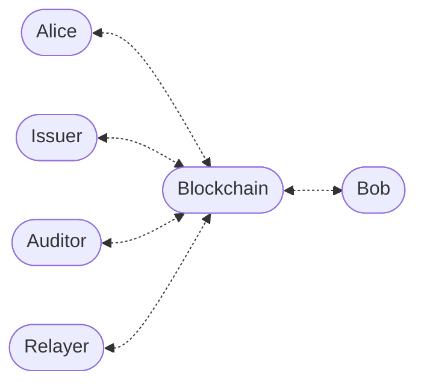

# Enygma DvP Private Swap Protocol

## System Entities

We assume a setting with three entities:

- Alice (the initiator)
- Blockchain (the verification and DvP coordination layer)
- Bob (the counterparty)
- Issuer (the administrator)
- Auditor (an authorized observer who can decrypt audit trails)
- Relayer (an authorized off-chain service that submits both proofs atomically)

### Adversarial Model

The adversary $$\mathcal{A}$$ aims to:

- break transactional privacy
- link inputs and outputs
- identify participants
- disrupt atomic settlement

We assume the blockchain correctly enforces the DvP smart contract logic and that the cryptographic primitives are secure.

---

## Key Generation

Each user generates:

- a **view keypair** using ML-KEM(post-quantum key encapsulation)
- a **spend keypair** using a hash-based construction (ZK-friendly)

$$
(pk^{\text{view}}, sk^{\text{view}}) \longleftarrow \mathrm{ML\text{-}KEM.KeyGen}()
$$

$$
sk^{\text{spend}} \longleftarrow {0,1}^{\lambda}, \qquad
pk^{\text{spend}} = \mathrm{H}(sk^{\text{spend}})
$$

where $\mathrm{H}$ is Poseidon (ZK-friendly hash).

**Key separation**: the spend key is used only inside ZK proofs;the view key is used only for key encapsulation.

---

## Registration

Each user publishes:

$$
(id, pk^{\text{view}}, pk^{\text{spend}})
$$

---

## Commitment Structure

Each note commitment has the following form:

$$
C= \mathrm{H}(pk^{\text{spend}}, salt, amount, token_{id})
$$

The owner can spend $Commitment$ by proving knowledge of $(sk^{\text{spend}}, salt, amount, token_{id})$ inside a ZK circuit and publishing the corresponding nullifier.

Each commitment is associated with exactly one leaf position in a Merkle sub-tree. The nullifier is:

$$
nf = \mathrm{H}(sk^{\text{spend}},\ globalIdx), \qquad globalIdx = treeNum \cdot 2^{d} + leafIndex
$$

where $leafIndex$ is the position of the commitment within sub-tree $treeNum$ and $d$ is the tree depth (8). Every circuit that spends from a vault, the Payment family as well as the DvP circuits, uses this formula (the retired Erc721 ownership circuit aside, see below) (`NullifierTree` in `gnark_circuits/primitives/Nullifier.go`). $treeNum$ is a public input: folding it in gives the same slot in two sub-trees two different nullifiers, and the contract also uses it to route the nullifier check to the right sub-tree's map.

The formula has no vault or asset domain, so one key's notes at the same $globalIdx$ in two vaults have the same nullifier (see [What the chain sees](#what-the-chain-sees-deposits-spends-and-exits)).

## Private Issuance

Before a user can participate in a DvP they need a private balance: a
commitment inserted into the on-chain Merkle tree that only they can spend.

Issuer steps:

1. Receives $(pk^{\text{spend}},\ amount,\ token_{id})$ from the recipient out-of-band.
2. Generates $salt \longleftarrow {0,1}^{\lambda}$.
3. Computes:

$$
C = \mathrm{H}(pk^{\text{spend}},\ salt,\ amount,\ token_{id})
$$

4. Generates a ZK proof $\pi$ (PrivateMint circuit) attesting:

- $C$ is well-formed for the given inputs
- $0 \le amount < 2^{128}$ (range check)
- a note tag $tag = \mathrm{H}(pk^{\text{spend}},\ salt,\ contractAddress)$
  binds the proof to this deployment

5. Submits $(\pi,\ C,\ tag,\ token_{id})$ to the smart contract, which
   verifies $\pi$ and inserts $C$ into the Merkle tree.
6. Delivers $salt$ privately to the recipient (out-of-band).

The recipient can now spend $C$ by proving knowledge of
$(sk^{\text{spend}},\ salt,\ amount,\ token_{id})$.

---

## DvP Overview

Alice and Bob agree on trade parameters:

- Alice sends $amount_{1}$ of $token_{id_{1}}$
- Bob sends $amount_{2}$ of $token_{id_{2}}$

We assume they each already hold input commitments:

$$
C^{\text{in}}A = \mathrm{H}(pk_A^{\text{spend}},\ salt_A^{\text{in}},\ amount_1,\ token{id_1})
$$

$$
C^{\text{in}}B = \mathrm{H}(pk_B^{\text{spend}},\ salt_B^{\text{in}},\ amount_2,\ token{id_2})
$$

The protocol enforces **atomic Delivery-versus-Payment (DvP)**:

- either both transfers occur
- or Alice recovers her funds through a revert commitment

---

## Transaction Structure (Alice → Blockchain)

| $\pi_{A}$ | CTXT | $C^{\text{out}}_B$ | $C^{\text{out}}_A$ | ENC_TX_DATA | $C^{\text{rev}}_A$ | $nf_{A}$ | deadline |
| :-------: | :--: | :----------------: | :----------------: | :---------: | :----------------: | :------: | :------: |

---

## Transaction Creation (Alice)

### Step 1 — ML-KEM Encapsulation

Alice encapsulates to Bob's view public key:

$$
(ss_{B}, \mathrm{CTXT}) \longleftarrow \mathrm{ML\text{-}KEM.Encaps}(pk_{B}^{\text{view}})
$$

---

### Step 2 — Key Derivation

Alice derives an encryption key:

$$
k = \mathrm{HKDF}(ss_{B}, \text{"encryption key"})
$$

Alice derives Bob's output salt:

$$
salt_{B}^{\text{out}} = \mathrm{HKDF}(ss_{B}, \text{"Bob salt"})
$$

Alice derives her own output salt:

$$
salt_{A}^{\text{out}} = \mathrm{HKDF}(ss_{B}, \text{"Alice salt"})
$$

Alice derives her own output salt for revert commitment:

$$
salt_A^{\text{rev}} \longleftarrow {0,1}^{\lambda}
$$

---

### Step 3 — Output Commitments

Bob's output commitment is:

$$
C^{\text{out}}B = \mathrm{H}(pk_B^{\text{spend}},\ salt_B^{\text{out}},\ amount_1,\ token{id_1})
$$

Alice's output commitment is:

$$
C^{\text{out}}A = \mathrm{H}(pk_A^{\text{spend}},\ salt_A^{\text{out}},\ amount_2,\ token{id_2})
$$

Revert commitment (Alice reclaims her asset if Bob times out):

$$

C^{\text{rev}}A = \mathrm{H}(pk_A^{\text{spend}},\ salt_A^{\text{rev}},\ amount_1,\ token{id_1})

$$

---

### Step 4 — Encrypt Transaction Data

Alice sets:

$$
m = token*{id*{1}} \parallel amount\_{1}
$$

and encrypts it as:

$$
\mathrm{[[TX_{ENC_TX_DATA}]]\_{k}} = \mathrm{AES\text{-}GCM.Enc}(k, m)

$$

This lets Bob verify what he will receive without Alice publishing plaintext on-chain.

---

### Step 5 — Nullifier

Let $leafIndex_A$ be Alice's leaf position in her sub-tree $treeNum_A$, and $globalIdx_A = treeNum_A \cdot 2^{d} + leafIndex_A$.

$$
nf_A = \mathrm{H}(sk_A^{\text{spend}},\ globalIdx_A)
$$

---

### Step 6 — Zero-Knowledge Proof (DvPInitiator circuit)

Alice generates $\pi_A$ proving (see §ZK Proof Statements for the full list).

---

Step 7 — Submission

$$
(\pi_A,\ \mathrm{CTXT},\ C^{\text{out}}_B,\ \mathrm{ENC_TX_DATA},\ C^{\text{out}}_A,\ C^{\text{rev}}_A,\ nf_A,\ treeNum_A,\ deadline)
$$

---

## Transaction Processing (Blockchain)

- the deadline is well-formed
- $block.timestamp \le deadline$
- $nf_A$ is not locked in sub-tree $treeNum_A$
- $nf_A$ is not spent in sub-tree $treeNum_A$
- $\mathrm{Verify}(\pi_A) = \mathrm{TRUE}$

If all checks pass:

$$
swap_{id} = \mathrm{H}(C^{\text{out}}_A,\ C^{\text{rev}}_A,\ nf_A,\ C^{\text{out}}_B,\ deadline)
$$

The blockchain:

- marks $nf_A$ as locked in sub-tree $treeNum_A$
- registers $swap_{id}$ as active with its deadline
- emits $(\mathrm{CTXT},\ C^{\text{out}}_B,\ \mathrm{ENC_TX_DATA},\ C^{\text{out}}A,\ swap{id})$

---

## Transaction Retrieval (Bob)

Bob receives: $\mathrm{CTXT},\ C^{\text{out}}_B,\ \mathrm{ENC_TX_DATA},\ C^{\text{out}}A,\ swap{id}$

---

### Step 1 — ML-KEM Decapsulation

Bob decapsulates:

$$

ss_B \leftarrow \mathrm{ML\text{-}KEM.Decaps} (sk_B^{\text{view}},\ \mathrm{CTXT})

$$

---

### Step 2 — Key and Salt Derivation

Bob derives the encryption key:

$$

k = \mathrm{HKDF}(ss_B,\ \text{"encryption key"})

$$

Bob derives his output salt and Alice's salt:

$$

\quad salt_B^{\text{out}} = \mathrm{HKDF}(ss_B,\ \text{"Bob salt"})

$$

Bob derives Alice's output salt:

$$

\quad salt_A^{\text{out}} = \mathrm{HKDF}(ss_B,\ \text{"Alice salt"})

$$

---

### Step 3 — Decryption

Bob decrypts:

$$

(token_{id_1},\ amount_1) = \mathrm{AES\text{-}GCM.Dec}(k,\ \mathrm{ENC_TX_DATA})

$$

If decryption fails, Bob aborts — the message was not addressed to him.

---

### Step 4 — Commitment Recompute

Bob recomputes his expected output commitment:

$$
\hat{C}B = \mathrm{H}(pk_B^{\text{spend}},\ salt_B^{\text{out}},\ amount_1,\ token{id_1}), \quad \hat{C}A = \mathrm{H}(pk_A^{\text{spend}},\ salt_A^{\text{out}},\ amount_2,\ token{id_2})
$$

Bob accepts if $\hat{C}_B = C^{\text{out}}_B$ and $\hat{C}_A = C^{\text{out}}_A$. Otherwise he aborts.

---

## Bob Completion

### Step 1 — Nullifier

Let $leafIndex_B$ be the leaf index of Bob's input commitment in sub-tree $treeNum_B$, and $globalIdx_B = treeNum_B \cdot 2^{d} + leafIndex_B$.

Bob computes:

$$
nf_B = \mathrm{H}(sk_B^{\text{spend}},\ globalIdx_B)
$$

---

### Step 2 — Zero-Knowledge Proof

Bob generates $\pi_B$ proving (see §ZK Proof Statements for the full list).

---

### Step 3 — Submission

$$
(\pi_B,\ C^{\text{out}}A,\ nf_B,\ treeNum_B,\ swap{id})
$$

---

## Finalization (Blockchain)

### Success Case

$$
(block.timestamp < deadline) ;\wedge; (\mathrm{Verify}(\pi_B) = \mathrm{TRUE}) ;\wedge; (nf_B\ \text{fresh in}\ treeNum_B) ;\wedge; (swap_{id}\ \text{active})
$$

The blockchain:

- marks $nf_A$ as spent in sub-tree $treeNum_A$
- marks $nf_B$ as spent in sub-tree $treeNum_B$
- inserts $C^{\text{out}}_A$ into the Merkle tree — Alice receives Bob's asset
- inserts $C^{\text{out}}_B$ into the Merkle tree — Bob receives Alice's asset
- marks $swap_{id}$ as completed

---

### Timeout / Failure Case

If Bob does not complete before the deadline, Alice triggers the revert path. The blockchain checks: $swap_{id}$ active, $block.timestamp \ge deadline$, $nf_A$ locked and not spent in sub-tree $treeNum_A$.

If valid:

- marks $nf_A$ as spent in sub-tree $treeNum_A$
- inserts $C^{\text{rev}}_A$ into the Merkle tree — Alice reclaims her asset
- marks $swap_{id}$ as failed

---

## Relayer Path (Optional)

When a relayer is registered, Alice and Bob submit their proofs off-chain to the relayer instead of directly to the blockchain. The relayer either submits both proofs atomically in one transaction, through $\mathrm{EnygmaDvp.swapOnGroupPair}()$ (or $\mathrm{exchangeOnGroupPair}()$):

$$
\text{Relayer} \xrightarrow{\;\pi_A,\;\pi_B,\;\text{all associated data}\;} \text{Blockchain}
$$

The off-chain relayer service (`relayer/`) takes this path, through $\mathrm{swap}()$ and $\mathrm{exchange}()$, which call these two with the fungible / non-fungible (or fungible / fungible) group pair fixed.

The owner registers and deregisters relayers at any time ($\mathrm{registerRelayer}$ / $\mathrm{deregisterRelayer}$). A relayer cannot forge proofs, and a lock it takes expires $\mathrm{MAX\_SWAP\_DURATION}$ after it is taken: from then on anyone can release it ($\mathrm{releaseExpiredRelayerLock}$), whether or not the relayer is still registered.

### SwapRelayer is test-only

The $\mathrm{SwapRelayer}$ contract files each leg as it arrives ($\mathrm{SwapRelayer.submitReceipt}()$): the first leg's note is locked ($\mathrm{EnygmaDvp.lockReceiptNullifiers}()$) until the second leg settles the swap through $\mathrm{EnygmaDvp.swap}()$, or until the swap's expiry (15 minutes to 30 days after the first leg), when anyone can cancel it ($\mathrm{SwapRelayer.cancelSwap}()$).

Only the Go tests deploy it; no deploy or init script deploys it or registers it, and the relayer service does not use it. **SwapRelayer must never be registered with $\mathrm{registerRelayer}$.** Registered, it would open these gaps:

- **Anyone can lock a published leg** (reconciled audit R-057). `submitReceipt` is permissionless and calls EnygmaDvp's relayer-only `lockReceiptNullifiers`, so anyone holding a published leg can lock its note until an expiry they pick, up to 30 days. That includes the counterparty's completing leg of a swap pending in EnygmaDvp.
- **Cancelling does not end the swap** (R-058). `cancelSwap` closes the swap only in SwapRelayer's own `closed` map and releases the lock. The cancelled leg is still a valid receipt, so the counterparty can still settle it through `EnygmaDvp.submitPartialSettlement`.
- **The expiry is not bound** (R-059). The first leg's `expiry` is a plain argument, checked only against the 15-minute and 30-day bounds; neither leg's proof binds it (the SwapRelayer form of #431).
- **The ciphertexts are not bound** (R-060). `ctI` and `ctII`, which the counterparty scans to discover the swap, are free arguments the leg proof does not bind, so a front-runner can file the leg first with false ciphertexts.
- **A cancel links the note's next spend** (R-061). `cancelSwap` releases the lock instead of spending the note into a fresh commitment, so the nullifier published with the cancelled leg is the one the note's next spend reveals. That links the spend to the leg and to whoever submitted it.

## What the chain sees: deposits, spends and exits

A note's commitment hides its owner, amount and token id, and a spend publishes a nullifier that only the owner can link to the note. The paths that move assets into or out of a vault are public, and spending in more than one vault can link notes. This section lists what each path publishes, as the code does it today.

### Deposits

`Erc20CoinVault.deposit(params)` and `depositV2(params, ciphertextI, ciphertextII)` take

$$
params = [amount,\ pk^{\text{spend}},\ salt,\ token_{id}]
$$

and `Erc721CoinVault.deposit(params)` takes $[token_{id},\ pk^{\text{spend}},\ salt]$ (amount 1). The vault pulls the asset from the caller and computes the commitment itself, $C = \mathrm{H}(pk^{\text{spend}},\ salt,\ amount,\ token_{id})$, so that the deposited amount and token are bound to the note (the C-1 fix: a commitment the caller computed could encode any amount).

As a result a deposit publishes the whole note opening in its calldata: the owner's spend public key, the salt, the amount and the token id, next to the depositor's address and the token transfer. The `UserRegistry` maps each registered account to its spend public key, so the deposited note's owner is public too. **Deposits do not hide the owner.** `depositV2` also emits `EncryptedNote(vaultId, C, ciphertextI, ciphertextII)` so that the owner's wallet can find the note by scanning; the ciphertext adds nothing the calldata does not already show.

What stays private is the note's later life: the nullifier that spends it needs $sk^{\text{spend}}$, so the chain cannot tell when, or into what, the deposited note is spent. A [private mint](#private-issuance) creates a note without revealing its opening.

### Nullifiers across vaults

The nullifier $\mathrm{H}(sk^{\text{spend}},\ globalIdx)$ has no vault or asset domain. Each vault numbers its own leaves from 0, so a key that holds a note at the same $globalIdx$ in two vaults (an Erc20 vault and the USDr vault, say) publishes the same nullifier value in both when it spends them. Each vault records its own spent nullifiers, so neither note can be spent twice, but anyone who sees the same nullifier in two vaults learns that one key owned both notes.

### Exits

Every withdrawal publishes its recipient address and amount: they are call arguments, the vault pays the recipient with an ordinary token transfer, and they open output 0 of the proof, which the vault recomputes as $\mathrm{H}(\mathrm{uint160}(recipient),\ 0,\ amount,\ token_{id})$ (or, for the legacy `withdraw`, $\mathrm{H}(uid,\ recipient)$).

| Function (`Erc20CoinVault`) | Receipt | Public | Change note |
| --- | --- | --- | --- |
| `withdrawV2(params, recipient, receipt)` | Payment or Payment2in, `StMessage = WITHDRAW_MESSAGE` | recipient, amount, token id; `PartialWithdrawal` event | inserted; no `EncryptedNote` |
| `partialWithdraw(params, recipient, receipt, ciphertextI, ciphertextII)` | as `withdrawV2` | as `withdrawV2` | inserted; `EncryptedNote` with the caller's ciphertexts |
| `partialWithdrawWithRelayerFee(...)` | PaymentRelayerFeePublic, `StMessage = WITHDRAW_MESSAGE` | as `withdrawV2`, plus the public fee | inserted, with the relayer's fee note; `EncryptedNote` with the caller's ciphertexts |
| `withdraw(params, recipient, receipt)` (legacy) | any Payment-family receipt | recipient, amount | not inserted |

The VK slots these functions use (Payment 0, Payment2in 1, PaymentRelayerFeePublic 3) are the dedicated Payment deployment's. The main deployment registers other circuits in slots 1-3, so there only the 1-input `withdrawV2`/`partialWithdraw` verifies; a Payment2in or relayer-fee receipt reverts.

The change note itself stays private: its commitment hides the remainder, and the spent inputs are hidden behind their nullifiers.

**The change note's ciphertexts are not bound to the proof.** The Payment-family statements have a `CiphertextHash` slot, which every payment path checks against the ciphertexts it publishes (`CiphertextHash.sol`), but `_settlePartialWithdraw` does not check it: it emits whatever `ciphertextI`/`ciphertextII` its caller passes. Anyone who sees a pending `partialWithdraw` or `partialWithdrawWithRelayerFee` can settle the same receipt first with other ciphertexts, or with none. The recipient, amount and outputs are fixed by the proof, so nothing can be redirected, but the owner's scan finds a false or missing ciphertext for the change note. The circuit fixes the change note's salt to $\mathrm{H}(sk^{\text{spend}},\ nf_0)$, so the owner can always rebuild the note from its key and the transaction's `Nullifier` and `PartialWithdrawal` events (`core.WithdrawChangeNote`), without the ciphertexts.

**The legacy `withdraw` is not domain-separated from payments.** `withdrawV2` and the partial withdrawals take only receipts whose `StMessage` is `WITHDRAW_MESSAGE`, and the payment paths refuse that value, so a withdrawal receipt settles only as a withdrawal. The legacy `withdraw` does not check `StMessage`: it takes a payment receipt (`StMessage = 0`), so a pending legacy-withdraw receipt can also be settled first as a payment (by any payment path whose ciphertexts match its `CiphertextHash`), which inserts output 0 as a note no one can spend instead of paying it out. It also spends the inputs without inserting any other output, so a change note in output 1 is lost. It does refuse locked notes.

### Erc721 vault: legacy paths

`Erc721CoinVault.transfer`, `withdraw` and `verifyOwnership` verify against VK slot 1 (`VK_ID_ERC721_1`), which the main deployment's config assigns to `OwnershipErc721`. That circuit's template is gone and its keygen is commented out (`gnark_circuits/cmd/keygen`), so no proof for these paths can be made. (Its nullifier was the old $\mathrm{H}(sk^{\text{spend}},\ leafIndex)$, which is why `checkReceiptConditions` takes these receipts only in tree 0.) NFTs move into the vault through `deposit` and leave it only as DvP legs (`checkDvpReceiptConditions`, VK slot 24), so an NFT never leaves the shielded pool for a public address.

---

## Setup and owner calls

### Setup call order

`scripts/cmd/init` makes the owner's setup calls in this order.
`scripts/cmd/init_payment` makes the subset the Payment deployment needs
(`initializeDvp`, its keys, then its two vaults) in the same order.

1. `Verifier.initializeVerifier`, then `Verifier.grantRole` so that
   `EnygmaDvp` may register verification keys.
2. `EnygmaDvp.initializeDvp(verifier)`, **once**.
3. `registerNewVerificationKey` for each key, then `registerPrivateMintVerifier`.
4. `registerVault` for each vault, then `registerAssetGroup`, the group pairs
   and `addVaultToGroup`.
5. `EnygmaErc20CoinVault.addEnygma`, **once** (see below), then
   `registerRelayer` if one is configured.

Never call `registerEnygmaAuction`: the auction in this module is legacy, and
the maintained one is [`enygma_dvp_auctions`](../enygma_dvp_auctions), which
uses its own vaults.

The order matters because a vault takes its addresses once and keeps them.
`registerVault` passes the verifier and auction addresses `EnygmaDvp` holds at
that moment to the vault's `initializeVault`, which runs only once.
`registerAssetGroup` reads the verifier from `EnygmaDvp` the same way. So:

- **A second `initializeDvp` does not reach registered vaults.** It changes
  only the address `EnygmaDvp` holds. Vaults and asset groups registered
  earlier keep verifying against the old verifier. Keys registered from then
  on go to the new one, so those vaults never see them. Vaults registered
  later use the new one. Nothing warns: the call emits no event and checks no
  state. To undo a mistaken call, call `initializeDvp` again with the first
  verifier's address.
- **A vault trusts the auction address that was stored when it was
  registered.** It grants that address `DEFAULT_AUCTION_ROLE` for good (today
  `address(0)`, as nothing calls `registerEnygmaAuction`).

### `addEnygma`'s powers

`EnygmaErc20CoinVault.addEnygma(addr)` is owner-only, but nothing stops a
second call. Each call:

- grants `addr` the vault's `DEFAULT_ENYGMA_ROLE`. Earlier holders keep the
  role, and no account can revoke it, because the vault has no role admin
  (only a holder can renounce its own role).
- rewrites the vault's asset address to `addr`. The asset address is an input
  to the note's unique id, so notes the vault inserts after the call have
  different unique ids from the notes inserted before it.

Every holder of the role can call `depositThroughEnygma`, which inserts a
bridge note for any amount and key without moving any tokens, and
`withdrawThroughEnygma`, which spends one. So the role should be held only by
the Enygma (institutional payments) contract: call `addEnygma` once per vault,
with that contract's address, as `scripts/cmd/init` does.

### Fee parameters

Each fee amount the contract checks is an owner-set value that starts at 0,
so until the owner sets it the check requires a fee of 0. No deploy or init
script sets an amount: `scripts/cmd/init_payment` and
`enygma_retail_payments/scripts/cmd/init` set only the USDr token id and vault,
and only the retail shield demo sets `usdrFixedFeeAmount`, for its own run.
After deploy, the owner (`DEFAULT_OWNER_ROLE`) sets each one with its setter:

| Parameter | Default | Setter | Checked by |
|---|---|---|---|
| `relayerFixedFeeAmount` | 0 | `setRelayerFixedFee(amount)` | `paymentWithRelayerFee`, `channelPaymentWithRelayerFee` |
| `usdrFixedFeeAmount` | 0 | `setUsdrFixedFee(amount)` | `paymentWithUsdrFee`, `channelPaymentWithUsdrFee` (USDr leg) |
| `usdrTokenId` | 0 | `setUsdrTokenId(tokenId)` | the same two calls; both init scripts set it to 0, its default |
| `usdrFeeVaultId` | unset | `setUsdrFeeVaultId(vaultId)` | the same two calls, which revert `InvalidUsdrVault` until it is set; both init scripts set it to 1 |

`paymentWithFee` and `channelPaymentWithFee` check against no stored value:
see R-049 below. Each `EnygmaDvp` payment entry point takes one receipt
shape, and reverts `InvalidStatementSize` on any other: `payment()`,
`channelPayment()` and the main leg of the `*WithUsdrFee` calls take a
Payment or Payment2in receipt, `paymentWithFee` and `channelPaymentWithFee`
a PaymentFee receipt, and the `*WithRelayerFee` calls a PaymentRelayerFee
receipt. So `EnygmaDvp` settles a PaymentRelayerFee receipt only where it
checks `relayerFixedFeeAmount`. The amount binds those relayer routes, not
the protocol: `Erc20CoinVault.transfer`, `transferV2` and
`partialWithdrawWithRelayerFee` settle a PaymentRelayerFee receipt with the
fee its prover chose, and a sender can pay a relayer any amount as output 0
of a plain payment, or pay none.

The off-chain relayers have their own floor, `RELAYER_MIN_FEE` (base units,
default 0). At 0 the relayer accepts any fee the contract accepts, so a relayer
that should be paid must set it, and both relayers (`relayer/` here and
`enygma_retail_payments/relayer/`) log a warning at startup when it is 0.

### Fee paths that bind less than they look

- **The USDr fee leg names its payment; the payment does not name its fee**
  (reconciled audit R-048). `paymentWithUsdrFee` and
  `channelPaymentWithUsdrFee` settle two receipts, the main payment and the
  USDr fee leg, each nullifying against its own vault. The fee leg's
  `StCiphertextHash` must be `CiphertextHash.ofUsdrFeeLeg`: keccak256 of a
  domain word, the hash of the main payment's statement (its public signals)
  and the fee note's ciphertexts, mod p. So the fee leg settles only in the
  same call as the payment it was proved for: `payment()`,
  `paymentWithFee()` and the channel calls refuse its shape, the vault's
  `transfer` and `transferV2` its ciphertext hash, and next to another
  payment the hash differs. The main receipt names no fee leg: anyone
  holding it can settle the payment alone, through `payment()` or
  `channelPayment()`, and the relayer's transaction then reverts unpaid.
  The payer keeps the USDr note, since its fee leg can no longer settle.
- **The PaymentFee fee is chosen by the prover and burned into the vault**
  (R-049). `paymentWithFee` and `channelPaymentWithFee` take only a
  PaymentFee receipt and compare its fee with their own `protocolFee`
  argument: the caller's expectation, which the caller also chooses, not a
  protocol policy, so the check enforces nothing. The PaymentFee circuit
  absorbs the fee into conservation
  (`Σ valuesIn = valOut[0] + valOut[1] + StFee`) rather than creating a note,
  so those tokens stay in the vault with no note to spend and no sweep to
  collect them.

### Front-running that blocks a call

Two public calls can be blocked by anyone who copies a pending transaction
from the mempool. Neither loses funds; the sender retries with fresh input.

- **Ownership challenges.** `Erc20CoinVault.verifyOwnership` takes
  the proof's message as a challenge and registers it through
  `EnygmaDvp.checkAndRegisterChallenge`, which rejects a challenge it has seen
  before (`RottenChallenge`). The function is public, and all vaults share one
  set of challenges. So anyone who sees a pending `verifyOwnership` can
  register its challenge first, or submit the same receipt themselves, and the
  owner's call reverts. To recover, the owner proves again with a new
  challenge.
- **Channel ids.** `ChannelRegistry.openChannel` stores the first record
  written under a `channelId` and rejects later ones
  (`ChannelAlreadyExists`). A copier can therefore open the sender's
  `channelId` first with a false ciphertext, and the sender's call reverts.
  The recipient would find the copier's address in the record's `sender`
  field and a ciphertext whose decapsulated secret does not hash to the
  channel id. To recover, the sender encapsulates again, which gives a new shared secret
  and so a new channel id (`SHA256(0x01 || sharedSecret)`), and opens that
  channel instead.

---

## Security Goals

- **Atomicity**: either both sides settle or Alice recovers her original asset
- **Privacy**: commitments hide owners, amounts, token identifiers, and linkage; deposits, exits and spends across vaults reveal what [What the chain sees](#what-the-chain-sees-deposits-spends-and-exits) lists
- **Fairness**: Bob cannot receive Alice's asset unless he spends his own input
- **Replay resistance**: nullifiers prevent double-spending
- **Timeout safety**: locked funds can be recovered after the deadline
- **Bounded griefing**: Bob can delay settlement only until the deadline

---

## Zero-Knowledge Proof Remarks

### Alice Proof: $\pi_{A}$

Alice's proof must enforce:

- $pk_A^{\text{spend}} = \mathrm{H}(sk_A^{\text{spend}})$
- $C^{\text{in}}A = \mathrm{H}(pk_A^{\text{spend}},\ salt_A^{\text{in}},\ amount_1,\ token{id_1})$
- $C^{\text{in}}_A$ is at $leafIndex_A$ in the Merkle tree with root $MerkleRoot_A$
- $nf_A = \mathrm{H}(sk_A^{\text{spend}},\ globalIdx_A)$
- $C^{\text{out}}B = \mathrm{H}(pk_B^{\text{spend}},\ salt_B^{\text{out}},\ amount_1,\ token{id_1})$
- $C^{\text{out}}A = \mathrm{H}(pk_A^{\text{spend}},\ salt_A^{\text{out}},\ amount_2,\ token{id_2})$
- $C^{\text{rev}}A = \mathrm{H}(pk_A^{\text{spend}},\ salt_A^{\text{rev}},\ amount_1,\ token{id_1})$
- $\mathrm{StMessage} = C^{\text{out}}_A$
- $0 \le amount_1,\ amount_2 < 2^{128}$

---

### Bob Proof: $\pi_{B}$

#### Alice's Proof $\pi_A$ — DvPInitiator Circuit

Public inputs: $(\mathrm{StMessage},\ treeNum_A,\ MerkleRoot_A,\ nf_A,\ C^{\text{out}}_B,\ C^{\text{out}}_A,\ C^{\text{rev}}_A,\ vault_B)$

The circuit enforces:

- $pk_A^{\text{spend}} = \mathrm{H}(sk_A^{\text{spend}})$
- $C^{\text{in}}A = \mathrm{H}(pk_A^{\text{spend}},\ salt_A^{\text{in}},\ amount_1,\ token{id_1})$
- $C^{\text{in}}_A$ is at $leafIndex_A$ in the Merkle tree with root $MerkleRoot_A$
- $nf_A = \mathrm{H}(sk_A^{\text{spend}},\ globalIdx_A)$
- $C^{\text{out}}B = \mathrm{H}(pk_B^{\text{spend}},\ salt_B^{\text{out}},\ amount_1,\ token{id_1})$
- $C^{\text{out}}A = \mathrm{H}(pk_A^{\text{spend}},\ salt_A^{\text{out}},\ amount_2,\ token{id_2})$
- $C^{\text{rev}}A = \mathrm{H}(pk_A^{\text{spend}},\ salt_A^{\text{rev}},\ amount_1,\ token{id_1})$
- $\mathrm{StMessage} = C^{\text{out}}_A$
- $0 \le amount_1,\ amount_2 < 2^{128}$
- $vault_B \ne 0$

$vault_B$ is the address of the vault Alice expects to be paid from (where $C^{\text{out}}_A$ is inserted). The commitments do not name a vault, so at settlement `EnygmaDvp` checks that Bob's leg really comes from $vault_B$ (and Bob's $vault_A$ symmetrically); otherwise it reverts with `CounterVaultMismatch`. Without this, a counterparty could pay from another vault in the same asset group.

Note: $globalIdx_A = treeNum_A \cdot 2^{d} + leafIndex_A$, so the circuit constrains the public $treeNum_A$ through the nullifier; the contract also uses it to route the nullifier check.

#### Bob's Proof $\pi_B$ — DvPDestination Circuit

Public inputs: $(\mathrm{StMessage},\ treeNum_B,\ MerkleRoot_B,\ nf_B,\ C^{\text{out}}_A,\ vault_A)$

The circuit enforces:

- $pk_B^{\text{spend}} = \mathrm{H}(sk_B^{\text{spend}})$
- $C^{\text{in}}B = \mathrm{H}(pk_B^{\text{spend}},\ salt_B^{\text{in}},\ amount_2,\ token{id_2})$
- $C^{\text{in}}_B$ is at $leafIndex_B$ in the Merkle tree with root $MerkleRoot_B$
- $nf_B = \mathrm{H}(sk_B^{\text{spend}},\ globalIdx_B)$
- $C^{\text{out}}A = \mathrm{H}(pk_A^{\text{spend}},\ salt_A^{\text{out}},\ amount_2,\ token{id_2})$
- $C^{\text{out}}B = \mathrm{H}(pk_B^{\text{spend}},\ salt_B^{\text{out}},\ amount_1,\ token{id_1})$
- $\mathrm{StMessage} = C^{\text{out}}_B$
- $0 \le amount_2,\ amount_1 < 2^{128}$
- $vault_A \ne 0$ (the vault Bob expects to be paid from, where $C^{\text{out}}_B$ is inserted)

Note: $globalIdx_B = treeNum_B \cdot 2^{d} + leafIndex_B$, as for Alice.

---

## Notes

- View keys are **ML-KEM keys**, not Diffie-Hellman keys.
- The DvP smart contract never learns the private salts.
- Bob verifies Alice's encrypted payload by AEAD authentication and commitment recomputation.
- Alice's input nullifier is first marked as locked, then later marked as spent.
- Bob's input nullifier is marked as spent only in the successful settlement path.
- The revert path consumes Alice's locked input and inserts $$\mathrm{REVERT_COMMIT}_{A}$$.
- Encryption correctness is not directly proven inside the zero-knowledge proof.
- Recipient-side validation is performed by decapsulation, decryption, and commitment recomputation.
  $$
