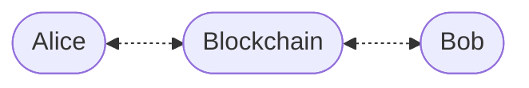

# Enygma Retail Payments Protocol

## System Entities

We assume a simple setting with three entities:

- Alice (the sender)
- Blockchain (the verification layer)
- Bob (the recipient)

### The owner

Payments settle in enygma_dvp's `EnygmaDvp` and its coin vaults. Paying, depositing and withdrawing need no role. The account holding `EnygmaDvp`'s `DEFAULT_OWNER_ROLE` is trusted with its settings: it registers and deregisters relayers, registers vaults and the private-mint verifier, flags vaults open to `privateMint` (which adds notes no deposit backs), and sets the fixed fees. The Verifier's owner registers the verification keys.

- **The role can move.** The deployer holds it, and `DEFAULT_ADMIN_ROLE`, which grants and revokes it. `scripts/cmd/init` hands both, and the Verifier's two roles, to the config's `owner.governance` when it names a contract, such as a Safe or an OpenZeppelin `TimelockController`, and renounces the deployer's. It refuses an address with no code, or a mixed-case one that fails its EIP-55 checksum, before it sends anything.
- **No delay of its own.** Each owner call takes effect in its own transaction. With a `TimelockController` holding the roles, every owner call is scheduled in public and runs only after the timelock's delay.
- **Every change is logged.** Each owner call emits its own event or `OwnerCall`, with the call's calldata; `registerPrivateMintVerifier` emits none.
- **The keys are frozen.** Init freezes the Verifier once its keys are in, before it registers the vaults, so nobody, the owner included, can add a key afterwards.
- **The vaults stay bound** to the `EnygmaDvp` they were registered with: their roles have no admin.

The fixed fees (`relayerFixedFeeAmount`, `usdrFixedFeeAmount`) bind only the calls that pay a relayer: `paymentWithRelayerFee`, `paymentWithUsdrFee` and their channel forms require a fee leg's public fee to equal them, and the other payment calls do not read them. Init sets both from the config. A change applies at once: a fee leg proved for the old amount then reverts, and its sender proves it again; no funds move. So a wallet should read the fee for each payment it proves, and the relayer, which simulates each call before it sends it, refuses such a leg without paying for it. See [Setup and owner calls](../enygma_dvp/dvp_protocol.md#setup-and-owner-calls) for the details.

### Adversarial Model

The goal of the adversary $$\mathcal{A}$$ is twofold: break the privacy of the system and disrupt the activity of the system. We assume that the adversary ...

---

## Key Generation

In this step, each user generates two key pairs: a view key pair (i.e., ML-KEM) and a spend key pair (i.e., a hash-based key).

First, the user generates an ML-KEM keypair. The purpose of this key is to allow for quantum-secure key agreements in the various transactions that take place.

$$
(pk^{\text{view}}, sk^{\text{view}}) \longleftarrow \mathrm{ML\text{-}KEM.KeyGen}()
$$

Each user also generates a spend keypair:

$$
(pk^{\text{spend}}, sk^{\text{spend}}) \longleftarrow \mathrm{Hash.KeyGen}()
$$

We envision a simple key pair where the secret key is a simple preimage and the public key is a hash digest of said preimage.

$$
sk_A^{\text{spend}} \longleftarrow \\{ 0,1\\}^\lambda
$$

$$
pk_A^{\text{spend}} = \mathrm{H}(sk_A^{\text{spend}})
$$

---

## Registration

Upon completion of the key generation stage, each user registers both public keys, together with their view secret key encrypted to the auditor (the audit ciphertexts). Therefore, each user publishes:

$$
(id, pk_i^{\text{view}}, pk_i^{\text{spend}}, ct_i^{\text{audit}})
$$

where $ct_i^{\text{audit}}$ is an ML-KEM-768 capsule to the auditor's public key and the AES-256-GCM encryption, under the key derived from its shared secret, of the seed of $sk_i^{\text{view}}$, with the capsule as associated data.

The output of this stage once different users register is a public-key record layer of the following style:

|   User   |       View Key       |       Spend Key       |
| :------: | :------------------: | :-------------------: |
|   $A$    | $pk_A^{\text{view}}$ | $pk_A^{\text{spend}}$ |
|   $B$    | $pk_B^{\text{view}}$ | $pk_B^{\text{spend}}$ |
| $\vdots$ |       $\vdots$       |       $\vdots$        |
|   $Z$    | $pk_Z^{\text{view}}$ | $pk_Z^{\text{spend}}$ |

### Audit ciphertexts

Every registration carries audit ciphertexts: the [UserRegistry](contracts/user_registry/UserRegistry.sol) rejects one without them. They are self-asserted. The contract checks only their lengths (1088 bytes for the capsule, 92 for the AES ciphertext), not that they open, nor that they open to $sk_i^{\text{view}}$ for the registered $pk_i^{\text{view}}$. A user can register well-sized junk, or another view key's ciphertexts, and the auditor then cannot read their notes.

So the auditor checks each registration after it is made: [AuditRegistrations](src/core/user_registry/audit.go) opens every registration's audit ciphertexts with the auditor's secret key and reports, per user, whether they open and whether the recovered view key's encapsulation key equals the registered $pk_i^{\text{view}}$. The auditor cannot tell a user who opted out from one who encrypted to a different auditor: either way the ciphertexts do not open. Making the ciphertexts verifiable on chain (a proof or an attestation at registration) is not part of the deployed contract.

### Registration fee

`register` requires `msg.value >= registrationFee` and keeps all of it. The fee defaults to 0. The contract's owner (its deployer) can set it at any time with `setRegistrationFee` and withdraw everything the contract holds with `withdrawFees`.

---

## Transaction Structure

We go over the case where Alice, who has an initial commitment $$C_{A}$$ sends Bob a payment.
The goal of the protocol is for Alice to non-interactively have the ability to send funds to Bob.

Each commitment is of the following form:

$$
Commitment = H(pk^{\text{spend}}, salt, amount, token_{id} )
$$

### Transaction Payload

Before proceeding with the description of the payment protocol, we higlight the tx structure of each private payment.

| Ciphertext (ML-KEM) | Destination Commitment | Change Commitment | Ciphertext (AES) | Nullifier | $\pi$ |
| :-----------------: | :--------------------: | :---------------: | :--------------: | :-------: | :---: |

### Retrieving Destination Keys

Before initiating a transfer, Alice must know the public keys associated with Bob. Therefore, Alice retrieves the pair $(pk_B^{\text{view}}$, $pk_B^{\text{spend}})$.

### Transaction Amount(s)

We assume that the commitment owned by Alice (i.e., $$C_{A}$$) contains a max amount $$v$$ that Alice can spend.
In our protocol, the sender (i.e., Alice) always sends the full amount in every transaction. The corresponding amount to the recipient and the remaining to a "change commitment".

We denote $$v_{1}$$ the amount being sent and $$v_{2}$$ the change amount. The amount $$v = v_{1} + v_{2}$$ is the amount owned by Alice in $$C_{A}$$.

### Token IDs

Each transfer is related to a specific token ID. We enforce this by having each commitment linked to a token ID. In fact, the token ID is one of the inputs to the commitment.

---

## Transaction Creation

### Step 1 — ML-KEM Encapsulation

Alice initiates a post-quantum key agreement step and obtains a ciphertext and a shared secret $$ss$$.

$$
(\mathrm{ctxt}, ss) \leftarrow \mathrm{ML\text{-}KEM.Encaps}(pk_B^{\text{view}})
$$

---

### Step 2 — Hash-based Key Derivation

Upon generating the shared secret, Alice must derive two values:

- a salt, which is used to mask/randomize the destination commitment
- a symmetric key, which is used to encrypt additional data that is appended to the transaction

We assume the existence of global system parameters: $$context_{k}$$ and $$context_{salt}$$. These parameters are simply domain-separation strings to be used as inputs to the Hash-based Key Derivation function to produce independent values to be used for encryption and randomness of the commitments.

#### Deriving a symmetric key

To derive a symmetric key, Alice simply uses the shared secret and the domain-separation string as input to the HKDF function and obtains a fresh symmetric key that Bob will also be able to derive on his side. This value will always be random due to the use of a new shared secret for every transaction that takes place in the network. We assume $$len_{k} = 256$$ bits as we want the construction to be within the extremely conservative quantum-secure bounds (i.e., AES-GCM-256).

$$
k = \mathrm{HKDF}(ss, context_{k}, len_{k})
$$

#### Deriving a destination salt

To derive a destination salt, Alice simply uses the shared secret and the domain-separation string as input to the HKDF function and obtains a fresh salt that Bob will also be able to derive on his side. This value will always be random due to the use of a new shared secret for every transaction that takes place in the network.

$$
\mathrm{salt_{B}} = \mathrm{HKDF}(ss, context_{salt}, len_{salt})
$$

#### Deriving a change salt

This case is slightly different. Alice needs a salt for the change commitment that only Alice knows, and that she can rebuild without stored state: the ciphertexts that go with a payment are not bound by the proof, so if someone else settles her receipt first with replaced ciphertexts, her own transaction reverts although her input note is spent. Alice therefore derives the change salt from her spend key and the nullifier of the transaction's first input note, which is published on chain, and the circuit requires exactly this salt for the change output of every payment and withdrawal.

$$
\mathrm{salt_{A}} = \mathrm{Poseidon}(sk_{A}^{\text{spend}}, nf_{0})
$$

---

### Step 3 — Commitment

Alice calculates the destination commitment (for Bob):

$$
\mathrm{Commitment_{B}}
= \mathrm{H}(pk_{B}^{\text{spend}} \parallel salt_{B} \parallel v_{1} \parallel token_{id} )
$$

Alice calculates the change commitment (for Alice):

$$
\mathrm{Commitment_{A}}
= \mathrm{H}(pk_{A}^{\text{spend}} \parallel salt_{A} \parallel v_{2} \parallel token_{id} )
$$

---

### Step 4 — Encrypt Transaction Data

We use $$[[m]]_{k}$$ to denote the symmetric encryption of message $$m$$ using key $$k$$.

In this context, the message $$m$$ contains the information regarding the token id and the amount being transferred as demonstrated below:

$$
m = \mathrm{token\_id} \parallel \mathrm{amount}
$$

To make the variable more explicit in context, we denote the encryption of this transaction data as written below:

$$
\mathrm{[[TX_{DATA}]]_{k}} = \mathrm{AEAD.Enc}(k, m)
$$

---

### Step 5 — Nullifier

Let $\mathrm{leafIndex_{A}}$ be the index of the spent note $$C_{A}$$:

$$
nf = \mathrm{H}(sk_A^{\text{spend}} \parallel \mathrm{leafIndex}_{A})
$$

---

### Step 6 — Submission

Alice submits the following payload:

| ML-KEM.CTXT | $$\mathrm{Commitment_{B}}$$ | $$\mathrm{Commitment_{A}}$$ | $$\mathrm{[[TX_{DATA}]]_{k}}$$ | $$\mathrm{nf}$$ | $\pi$ |
| :---------: | :-------------------------: | :-------------------------: | :----------------------------: | :-------------: | :---: |

---

## Transaction Processing (Blockchain)

The blockchain, upon receiving a transaction payload, checks if the nullifier does not appear on the spent list and checks if

$$
\mathrm{Verify}(\pi) = TRUE
$$

If both clauses pass, then the transaction gets added to the blockchain and both commitments are inserted into the Merkle Tree.

---

## Transaction Scanning (Bob)

The above mentioned payload is published (and verified) by the blockchain.

### Step 1 — Private Information Retrieval

Bob performs a simple trivial private information retrieval protocol. Concretely, Bob downloads every single transaction that takes place in the network. Effectively, Bob is going to try to decrypt all transactions in the network and see if any contains funds for him.

---

### Step 2 — ML-KEM Decapsulation

Upon downloading a transaction, Bob runs the ML-KEM Decapsulation algorithm to obtain the shared secret. We note that this operation will always return an output value. However, Bob will not be able to infer whether or not this value is valid. We address this subsequently in the protocol.

$$
ss' \leftarrow \mathrm{ML\text{-}KEM.Decaps}(sk_B^{\text{view}}, \mathrm{ctxt})
$$

---

### Step 3 — Hash-based Key Derivation

Similarly to Alice, Bob must now derive the symmetric key and the salt from the shared secret value.

#### Deriving a symmetric key

$$
k' = \mathrm{HKDF}(ss', context_{k}, len_{k})
$$

#### Deriving a salt

$$
\mathrm{salt'} = \mathrm{HKDF}(ss', context_{salt}, len_{salt})
$$

---

### Step 4 — Decrypt

We introduce a step to inform Bob if the shared secret is valid for this specific transaction or not. Since this is an authenticated encryption (with associated data) scheme, Bob will know if the key used to decrypt is correct as the authentication component of the cipher will succeed.

Upon successful decryption, Bob obtains the information needed to open the received commitment (i.e., token id and received amount).

$$
(token_{id}, v') = \mathrm{AEAD.Dec}(k', \mathrm{[[TX_{DATA}]]_{k}})
$$

---

### Step 5 — Recompute Commitment

$$
\mathrm{Commit}' = \mathrm{Commit}(pk_B^{\text{spend}}, \mathrm{salt}',  v' , \mathrm{token\_id})
$$

Accept iff:

$$
\mathrm{Commit}' = \mathrm{Commitment_{B}}
$$

Upon successful equality, Bob is now able to open the commitment and can spend the commitment using his spend key.

---

## Auditing

This construction provides different types of auditing properties.

### Single Transaction Auditing

TBD

### Long-Term Auditing

TBD

---

## Security Goals

- Privacy
- Auditability

---

## Zero-Knowledge Proof Remarks

The ZK proof submitted by Alice must include the following clauses:

- I am spending a commitment in the tree
- Here's a (private) Merkle Proof of inclusion to show that this commitment is part of the tree
- I know the spend key associated with the commitment being spent (i.e., I know the preimage of the hash-based key)
- The nullifier $$nf_A$$ is obtained by hashing the spend key and the leafIndex where this commitment is located in the tree
- The destination amount is the same as the amount that I'm spending (plus the amount in the change commitment)
- Commitment_A is well formed (i.e., follows the H(x, y, z, w) structure)
- Commitment_B is well formed (i.e., follows the H(x, y, z, w) structure)
- The token_id in both output commitments is the same as the token_id in the commitment I'm spending

TBD: Do we want to enforce that the change commitment has the sender as the owner? (i.e., it uses the spend key of Alice)

## Notes

- View keys are **ML-KEM keys (not Diffie–Hellman)**
- Single-input spend (no anonymity set)
- Recipient detection is implicit via decapsulation + AEAD check

### Confidential Compliance

This protocol supports an additional extension: the ability to prove that each transaction falls under a specific threshold (e.g., an AML limit)

## Private tags

### Channel setup limits

The retail [UserRegistry](contracts/user_registry/UserRegistry.sol) has no
registration cap or removal operation. Its registration fee defaults to zero.
The [channel setup client](private_tags/src/channel.go) allocates one bit for
each registered user, so a registry of `N` users requires `(N + 7) / 8` bytes
with integer division, even when few bits are set.

- **Contract limit.** [TagChannelRegistry](private_tags/contracts/TagChannelRegistry.sol)
  rejects bitmaps over `BITMAP_MAX` (16,384 bytes). The highest representable
  user index is 131,071, counting from zero. Once the registry reaches 131,073
  users, the standard client bitmap exceeds the cap in every privacy mode.
- **Relayer gas limit.** The [retail relayer](relayer/server/handler.go) sends
  `openChannel` with a fixed budget of 8,000,000 gas. A dense bitmap can
  exceed that budget at around 79,000 registered users. This is an estimate
  that depends on how many bits are set and how much ciphertext is stored.

The relayer refuses a bitmap over `BITMAP_MAX` or with no bit set, and a `c2`
or tag `ctxt` over 4,096 bytes, with 400 before it calls the chain. It then
simulates `openChannel` and `publishTag` within its 8,000,000 gas budget, and it
answers 422 without sending the transaction when the simulation reverts or
runs out of gas. The simulation runs against the latest block, so it cannot
see the relayer's other tags still waiting for the next one: `publishTag`
allows 10 tags per block from one address, and the relayer is that address
for every tag it relays. An 11th tag for the same block passes simulation
and reverts on-chain.

### Standalone tag publication

The sender computes `Poseidon3(blockNumber, pk, ss)` off chain for a chosen
block number. [TagRegistry.publishTag](private_tags/contracts/TagRegistry.sol)
takes the tag and ciphertext and stores them under the transaction's inclusion
block (`block.number`). If the chosen block and inclusion block differ, a
recipient scanning the inclusion block derives a different tag and misses the
entry.

The relayer's former window mode predicted the next block, selected that
block's tag from a client-supplied window, and allowed up to three attempts.
It retried a mismatched tag only if the inclusion block was still inside the
window. The current `/relay/tag` route accepts a single precomputed tag
and ciphertext and submits them once. Tag-channel payments now use the
[ChannelPayment flow](../enygma_dvp/contracts/core/contracts/EnygmaDvp.sol),
which carries the chosen block number in its event and allows inclusion
through 100 blocks after that number.
